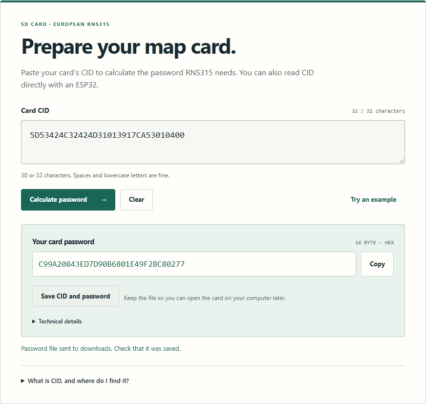
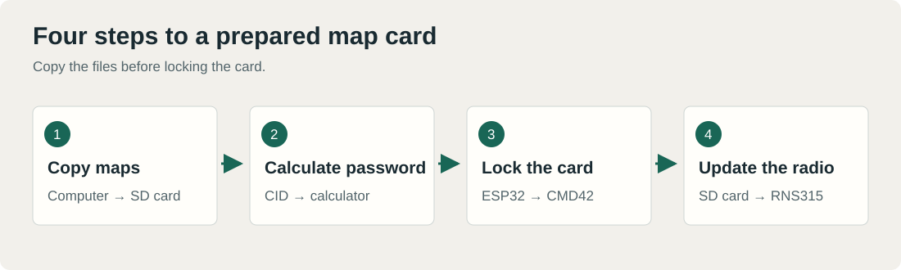
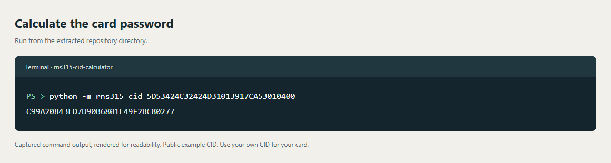

# RNS315 · CID calculator and map update guide

This is the tool I put together while updating the maps in my Passat's RNS315. It calculates the SD card password on your computer, so you don't need to buy a password or capture one with an SD sniffer.

**[Follow the map update guide](docs/update-maps.md)** · **[What I've tested](docs/tested-results.md)** · **[How I worked it out](docs/how-i-built-it.md)**

## Tested on real cards

**I've made two SD cards with this method and checked that both work in my RNS315.** I also compared the calculator's output with CID/password pairs I found publicly. All ten public examples in the test set match, byte for byte.

The [test results](docs/tested-results.md) cover those card checks, the public examples and the software tests. My own card CIDs and passwords stay private.



## Quick start

1. On GitHub, select **Code → Download ZIP** and extract the entire archive.
2. Double-click **Open-Calculator.html** to open the calculator.
3. Paste your card's CID and click **Calculate password**. With the ESP32 setup, **Read CID** fills it in automatically.
4. Click **Save CID and password**, then follow the [guide](docs/update-maps.md) to copy maps, lock the card and update the radio.

The calculator runs straight from the folder. Use desktop Chrome or Edge if you want it to talk to the ESP32 as well.

## What you need

| Item | Purpose |
|---|---|
| 8–32 GB SDHC card, preferably 16 or 32 GB | Store the maps on a single FAT32 partition. |
| Built-in SD slot or ordinary USB card reader | Copy map files from your computer. |
| Classic ESP32-WROOM-32 / ESP32 DevKit, SD module and jumper wires | Read CID and set the CMD42 password in the walkthrough below. A compatible native PC reader may replace this setup. |
| RNS315 V12 EU West map package | See [map sources](docs/map-downloads.md). |

The guide uses a full-size MH-SD module with a suitable regulator and level shifting. It accepts full-size SD cards and microSD cards in passive SD adapters. Wire it by the printed pin names, using the [diagram](docs/update-maps.md#4-connect-the-esp32-and-sd-module).

### Already have an SD slot in your computer?

You **may be able to skip the ESP32** if the reader exposes native SD/MMC access and your software supports both CID reads and CMD42 password locking. A built-in slot alone doesn't guarantee this, and a passive microSD-to-SD adapter is fine in principle. **I haven't tested the native-reader route myself; my two working card tests used ESP32.** The [reader notes](docs/native-sd-readers.md) cover the published examples, the limitations and a read-only Linux check.

## The workflow



**Copy maps → read CID → calculate and save the password → lock the card → insert it into RNS315.**

Copy the files before locking the card. CMD42 password locking is different from the physical LOCK switch on an SD adapter. **Open card for PC** removes the calculated RNS315 password when you want to use an ordinary USB reader again.

## How it started

I wanted to understand why copying the right map files wasn't enough, and why I had to buy a password for a card I already owned. **Daniel Kučera (danman)** had shown how to capture the password the radio expects using an SD sniffer, a logic analyzer and PulseView. His write-up gave me a useful starting point.

I handled the equipment, wiring, cards and tests in the car. I used AI to help with the app, coding and the harder parts of the firmware analysis. We recovered the calculation from European RNS315 firmware, which let me calculate the password directly from CID. The [project story](docs/how-i-built-it.md) explains how, and the [technical notes](docs/technical-analysis.md) give the exact steps. Danman's [original article](https://blog.danman.eu/updating-rns315-maps-for-fun-and-profit/) gets full credit for the earlier sniffing work.

Preparing RNS315 cards was already possible. For example, [vw_mmc-tools](https://github.com/TudorGruian/vw_mmc-tools) documents changing a card to a known CID and using its known password. This repo takes the card's existing CID and calculates the matching password locally, with the rule and source included. That's what it adds alongside the walkthrough and my card tests; I'm not claiming to have invented SD locking or RNS315 map updates.

## Terminal use

With Python 3.10 or later, from the repository directory:

```text
python -m rns315_cid 5D53424C32424D31013917CA53010400
```

Expected output for this public example:

```text
C99A20843ED7D90B6801E49F2BC80277
```



No Python packages are needed. Add `--json` for normalized CID and CRC details. Both 30- and 32-character input are accepted; the calculator rebuilds CRC7 automatically.

## Source and verification

The browser calculator, Python calculator, ESP32 program, firmware decoder and public test data are all here. You can read the calculation, run it yourself and change the code.

```text
python -m unittest discover -s tests -v
node tests/test-password-calculator.cjs
node tests/test-card-connection.cjs
```

The tests cover public CID/password vectors, independent CRC and MD5 checks, invalid input and serial framing. [Developer notes](docs/development.md) describe the program and ESP32 build. [Research reproduction](research/README.md) explains how to repeat the firmware decoding with your own source file.

## Supported system and maps

This project targets **European RNS315**. Firmware 0270 is the analyzed source, not a requirement for running the calculator. RNS310, RNS510, Discover Media/Pro and other regions use different formats or procedures.

Map data and radio firmware are not included. See [V12 EU West sources](docs/map-downloads.md) for an Italian map-package page and an alternative with a prepared SD card.

## Where things live

```text
Open-Calculator.html       Open this to get started
calculator/                Browser app and its offline guide
sd-card/                   ESP32 program and Windows flashing helper
docs/                      Update guide, results, explanation and images
rns315_cid/                Python calculator — no extra packages needed
tests/                     Calculator, connection and browser checks
research/                  Firmware decoder and analysis instructions
scripts/                   Rebuild the guide and its illustrations
```

For the usual card setup, start with the guide and use `calculator/` and `sd-card/`. The [developer notes](docs/development.md) explain the rest.

## License

[MIT](LICENSE) for the project's own code and illustrations. Map data, firmware and third-party tools retain their own licenses. See the [credits](docs/credits.md).
