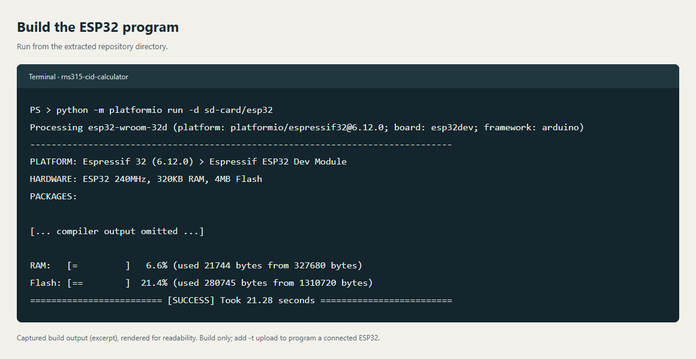

# Working on the code

The folders are grouped by what you want to work on: `calculator/` for the browser app, `sd-card/` for ESP32, `research/` for the firmware analysis and `tests/` for the checks. The Python package stays in `rns315_cid/` so you can still run it from the repository root without installing it.

`calculator/assets/password-calculator.js` and `rns315_cid/calculator.py` implement the same calculation independently. The browser needs no packages or server. Input accepts only 30 or 32 hexadecimal characters after whitespace removal, within a 256-character field.

`calculator/assets/card-connection.js` handles one Web Serial request at a time. It bounds input length, uses timeouts, rejects error frames and never retries a password write automatically. `calculator/assets/interface.js` binds the password to the card's freshly read CID and renders user values only as text. CID and password are not stored in cookies or browser storage. A password file is generated only when requested.

`sd-card/esp32/src/card-tool.cpp` is the project's own SPI transport, generalized from its earlier card-bound utility. It validates register CRC16, identity, advertised password-command support and status. `PREPARE` keeps a password temporarily in RAM and creates a random one-use token. `COMMIT` checks the token, expiry and card identity again before CMD42. Allowed operations are **SET_PWD | LOCK** (`0x05`) and **CLR_PWD** (`0x02`). There is no force-erase, sector-write or CID-change function.

## Build and test

From the repository root:

```text
python -m unittest discover -s tests -v
node tests/test-password-calculator.cjs
node tests/test-card-connection.cjs
python -m platformio run -d sd-card/esp32
```

The ESP32 platform is pinned to `espressif32@6.12.0`. A build does not connect to hardware. `-t upload` programs a connected ESP32. Only distribute ESP32 binaries built from this repository's general-purpose source.



Public comparison data lives in `tests/fixtures/public-cid-password-pairs.json`. [Provenance](public-test-vectors.md) distinguishes direct sources from public search excerpts. Keep private passwords, maps, firmware, raw logs and vehicle files out of Git.

## Serial protocol

115200 baud, one ASCII command per line:

```text
READ
PREPARE LOCK <32-CHAR-CID> <32-CHAR-PASSWORD>
COMMIT <8-CHAR-TOKEN>
PREPARE CLEAR <32-CHAR-CID> <32-CHAR-PASSWORD>
CANCEL
```

The regular user interface is the browser. Startup and `READ` send no CMD42. Never blindly repeat a password command after a timeout: read card status first.

References: [Web Serial](https://developer.mozilla.org/en-US/docs/Web/API/Web_Serial_API), [Chrome serial guide](https://developer.chrome.com/docs/capabilities/serial), [PlatformIO ESP32](https://docs.platformio.org/en/latest/boards/espressif32/esp32dev.html).

## Browser checks and guide generation

The calculator itself needs no npm packages. For development:

```text
npm install
npx playwright install chromium
npm run test:browser
```

The browser test checks validation, password download, mobile layout, guide images and a simulated serial exchange. It does not access connected hardware. Screenshots use the public example from the test fixtures.

Playwright uses its bundled Chromium by default. Set `PLAYWRIGHT_BROWSER_CHANNEL=chrome` if you prefer an installed Chrome browser.

To regenerate the SVG illustrations and local HTML guide:

```text
python -m pip install -r scripts/requirements.txt
python scripts/build_user_guide.py
```

Terminal images contain captured output from the documented public calculator command and an ESP32 build, rendered for readability. The lock-status image is an expected-output example, and the radio screens are illustrations.

## Build the beginner release

The release builder uses an explicit file list. It includes the four compiled classic-ESP32 images inside the offline installer, plus the calculator, guide and license notices. It never collects private records or the working directory as a whole.

```text
npm ci
python -m pip install platformio==6.1.18
python -m platformio run -d sd-card/esp32
python scripts/build_release.py
npm run test:release
```

`PLATFORMIO_CORE_DIR` or `--platformio-core` selects a non-default PlatformIO directory. Output goes to `dist/RNS315-Easy-Start.zip`, with `SHA256SUMS.txt` alongside it. `release-info.json` records the source commit and firmware hashes. The installer bundles pinned esptool-js and verifies the images before offering installation; it also requests MD5 readback verification while flashing.

Release tests exercise the real ZIP in Chrome and Edge. Installer success and failure paths use simulated serial/loader objects; they do not flash connected hardware.

Fault-injection coverage and the recovery deadlines are documented in [adversarial-testing.md](adversarial-testing.md). The card app requires a single unambiguous status report and an acknowledgement of the exact requested password operation before it sends `COMMIT`. Cleanup invalidates the old connection before waiting for the driver, so a stalled driver cannot keep the interface busy indefinitely.
