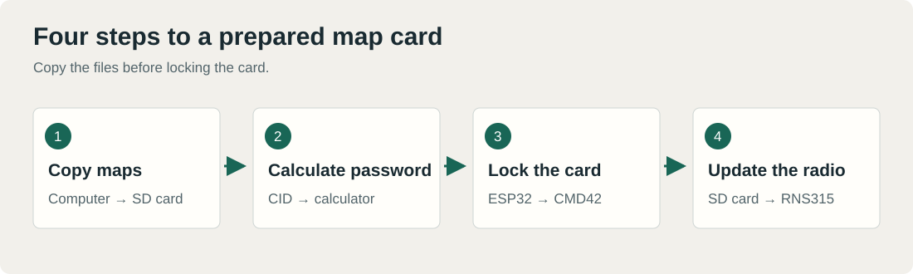
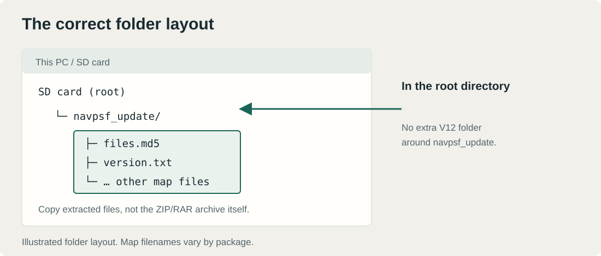
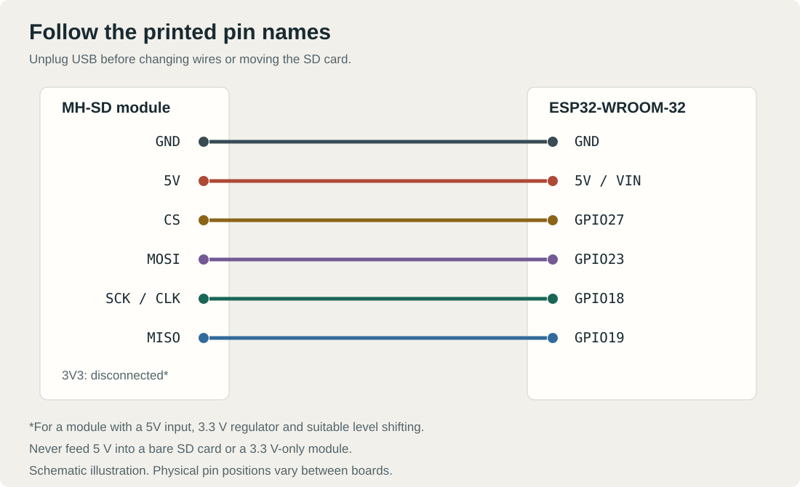
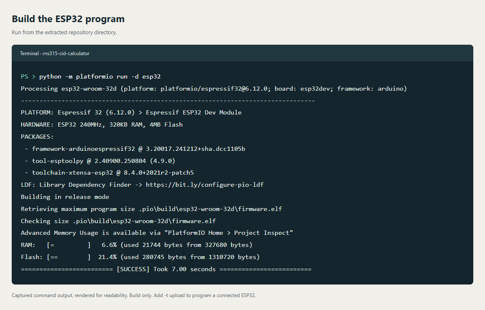
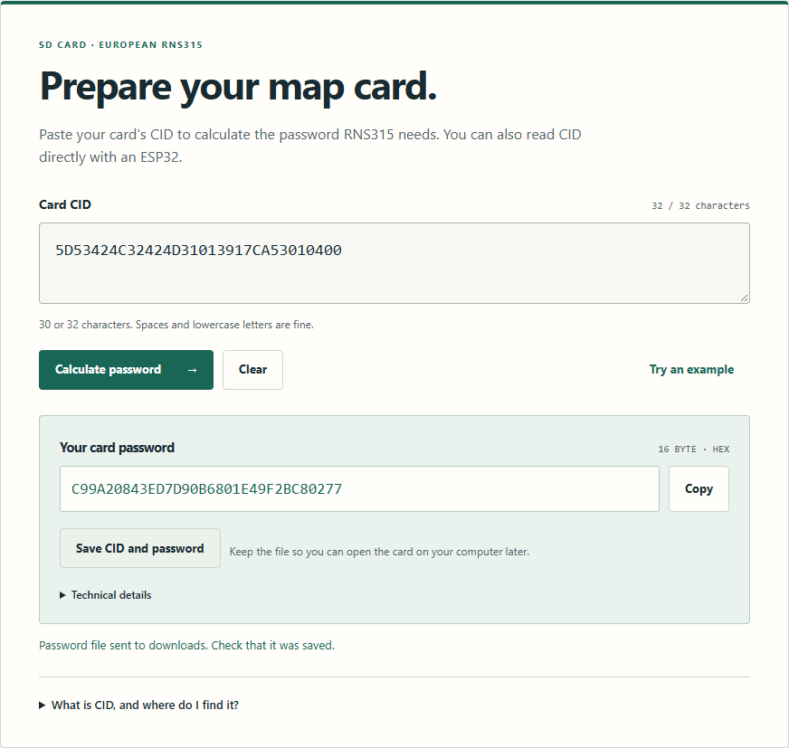
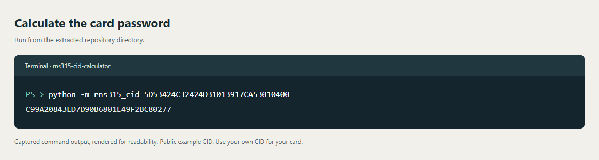
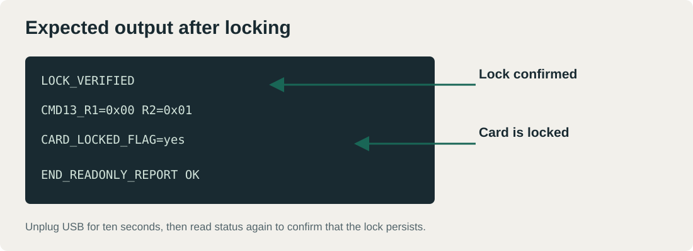
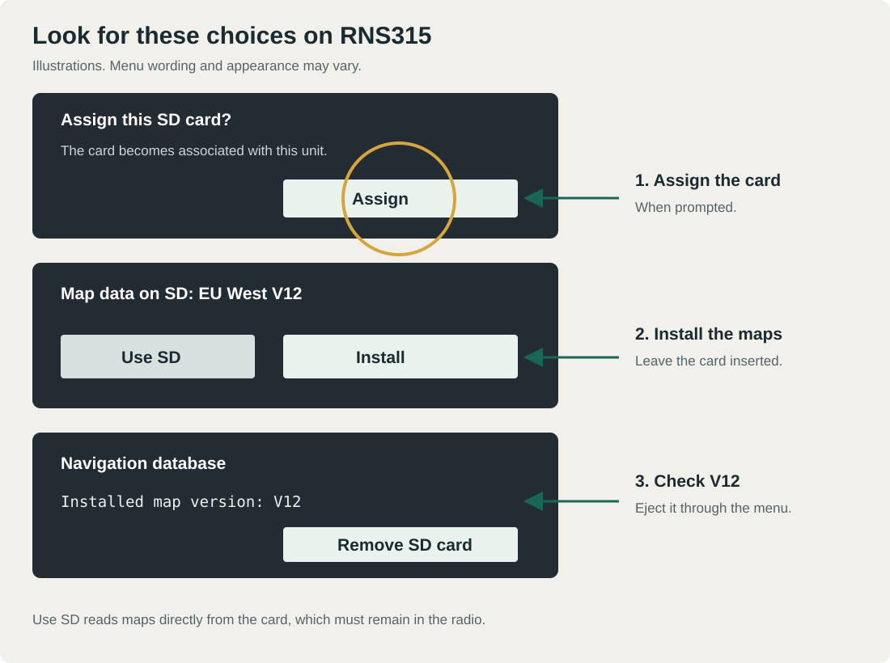

# Update RNS315 maps, step by step

Copy the maps first, set the card password, then let the radio use or install the maps. The illustrations and terminal examples show what to do and which output to look for.



## 1. Download and open the tool

1. On GitHub, select **Code → Download ZIP**.
2. Extract the entire ZIP. Do not open the tool inside the ZIP preview.
3. Double-click **START.html**. Use desktop Chrome or Edge if you want to connect an ESP32.

The calculator works offline. Installing the ESP32 build tools for the first time needs an internet connection.

## 2. Get the right maps

Use **RNS315 V12 EU West / Western Europe**, also called **EUR_W_V12**. This package includes Norway. [Map sources](maps.md) includes an Italian page for the package and a prepared-card alternative.

Check that your radio is RNS315: hold **SETUP** for about ten seconds and open **Versions**. You do not need to update the radio firmware to run this calculator.

## 3. Copy maps to the SD card

Prefer a **16 or 32 GB SDHC card**, with one **FAT32 partition in MBR**, preferably using **32 KiB clusters**. Back up anything you want to keep before formatting. Formatting deletes files on the selected card; check its capacity and drive letter carefully.

1. Put the card in an ordinary USB reader.
2. Extract the map archive on your computer.
3. Copy **navpsf_update** directly into the card's root directory.
4. Open that folder on the card. It should contain **files.md5**, **version.txt** and the map files.
5. Safely eject the card in your operating system.



**Correct:** `SD card/navpsf_update/files.md5`

**Wrong:** `SD card/V12/navpsf_update/files.md5`

Copy the whole extracted package without changing filenames. Do not copy the ZIP/RAR archive itself or change the card's CID.

## 4. Connect the ESP32 and SD module

Use a **classic ESP32-WROOM-32 / ESP32 DevKit**, a USB data cable, six jumper wires and an SD module. This wiring uses a **full-size MH-SD module with a labeled 5V input, a 3.3 V regulator and suitable SPI level shifting**.

**Unplug USB before changing wires or moving the card.** Follow the printed pin names, not their physical position: ESP32 boards have different layouts.



| SD module | ESP32 |
|---|---|
| GND | GND |
| 5V | 5V / VIN from USB |
| CS | GPIO27 |
| MOSI | GPIO23 |
| SCK / CLK | GPIO18 |
| MISO | GPIO19 |
| 3V3 | Leave disconnected on this 5V module |

**Never feed 5 V into a bare SD card or a 3.3 V-only module.** If your module only has a 3V3 input, use its specified 3.3 V supply and follow its documentation. ESP32 signal pins use 3.3 V.

Keep the wires short. On modules with two pins per label, use one row consistently and check the labels. An SCK wire shifted by one position is easy to miss.

## 5. Install the ESP32 program

Do this once. Leave the SD socket empty while programming.

**Windows:** install [Python 3 with Python Launcher](https://www.python.org/downloads/windows/), then double-click **Flash-ESP32.cmd**. The script creates a local tool environment, installs PlatformIO and uploads this repository's program to ESP32. It replaces the existing ESP32 program; it does not upload anything to the radio.

**Linux/macOS**, or if you already use PlatformIO, run these commands from the repository directory:

```text
python -m pip install platformio==6.1.18
python -m platformio run -d esp32 -t upload
```

If several microcontrollers are connected, disconnect the others first. Close other serial monitors. If uploading stops at **Connecting**, hold **BOOT** until the connection starts, then release it. Do not hold BOOT during normal use afterwards.

**Expected final message:** `SUCCESS`. Unplug USB, insert the prepared SD card into the module, then reconnect USB.

You can build the program without uploading anything:

```text
python -m platformio run -d esp32
```



The screenshot shows a build. Adding `-t upload` also programs the connected ESP32.

## 6. Read CID and save the password

1. Open **START.html** in Chrome or Edge.
2. Click **Connect ESP32** and select its serial port in the browser's dialog.
3. The tool reads CID and calculates the password. **Read CID** refreshes it when needed.
4. Click **Save CID and password**.
5. Check that **rns315-card-password.txt** was saved in your downloads folder. Keep it on your computer.



The screenshot uses a public example. **Your card has its own CID and password.** If you already read CID with another tool, paste it into the calculator and click **Calculate password**.

### Terminal alternative

Open a terminal in the extracted repository directory and run:

```text
python -m rns315_cid 5D53424C32424D31013917CA53010400
```



Replace the example with your card's CID. The command prints the 32-character hexadecimal password. This command only calculates the value; use the browser's ESP32 controls for card locking.

## 7. Lock the card

1. Check the box confirming that the maps are copied and you have saved CID and password.
2. Click **Lock card for RNS315** and confirm.
3. Wait for **Card is locked**. Technical status shows `LOCK_VERIFIED`, followed by a fresh status read.
4. Click **Disconnect**, unplug USB and wait ten seconds. Leave the card in the module.
5. Reconnect USB, choose **Connect ESP32**, and check that the card is still reported as locked after power was removed.
6. Disconnect again and unplug USB before removing the card.



This is an expected-output example. After locking, an ordinary USB reader may report an inaccessible card. Do not format it. The physical LOCK switch does not perform CMD42 password locking.

## 8. Update the radio

1. Park the car and maintain stable power during installation. Use appropriate battery support for a long session; never run an engine in an enclosed space.
2. Insert the card into RNS315 and wait about ten seconds.
3. If prompted to **Assign** the card, select that option. Read the dialog: the card becomes associated with the unit.
4. Look for **EU West V12 / EUR_W_V12** in the map information.
5. Choose **Install** to copy maps into the radio. **Use SD** uses the maps directly from the card, which must remain inserted.
6. Wait for completion. Allow plenty of time: a full installation can take around two hours or more. Do not remove the card or force a reset during copying.
7. Open **Navigation database / Versions** and check the installed V12 version. Use **Remove SD card** in the radio menu before physically removing it.



*Radio screens are illustrations. Labels and appearance vary with language and software version.*

With normal shutdown, map installation can continue when the radio is switched on again. Keep the same card inserted and its contents unchanged between sessions. Follow the message on your screen; normal shutdown and a forced reset are different operations. See the [owner's manual](https://manualzilla.com/doc/5919683/rns-310--rns-315).

## Open the card on a computer again

1. Eject it through the radio menu and wait for confirmation.
2. With ESP32 unplugged, insert the card into its SD module. Connect USB.
3. Open the calculator and click **Connect ESP32**. CID and the calculated password appear.
4. Save the password, check the confirmation box and click **Open card for PC**.
5. Wait for **Card is open** / `PASSWORD_CLEAR_VERIFIED`.
6. Disconnect and unplug USB before moving the card into your USB reader.

This uses the password calculated for that CID. It will not open a card locked with a different custom password. To prepare it for RNS315 again, repeat the locking step.

## Troubleshooting

| What you see | What to do |
|---|---|
| No ESP32 in the port list | Try a USB data cable, check its USB driver and close other programs using the port. |
| CMD0 or CID read error | Unplug USB. Check power, GND and SCK/MISO/MOSI/CS wiring. |
| ESP32 connected but no response | Check that this repository's program is installed. Reconnect without holding BOOT. |
| Card does not support password commands | Use an SDHC card with CMD42 support. Capacity or brand alone does not guarantee support. |
| Card remains locked after a power cycle | That is the expected state before moving it to RNS315. |
| SD error in the radio | Check the RNS315 map format, folder layout and password for the actual card's CID. |

You do not need an SD sniffer for this workflow. The [earlier sniffing work is credited here](../CREDITS.md).
